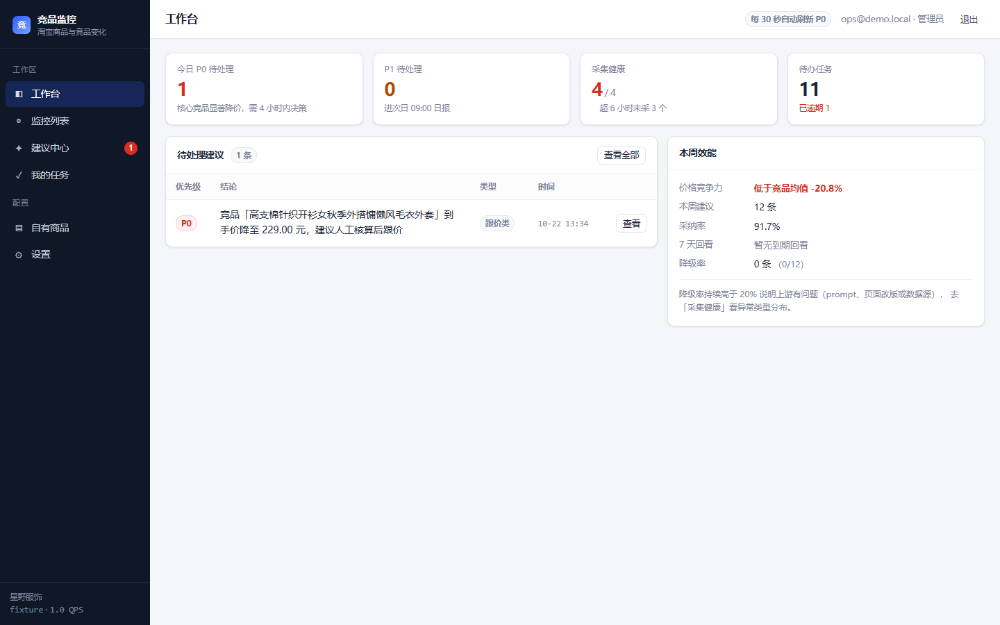

# 淘宝商品与竞品监控 Agent

[](https://github.com/Jactbct/competitor-monitoring-assistant-)

把竞品的**价格 / 促销 / 标题**变化，翻译成「改什么、谁来做、值不值得」的可执行建议。
按《架构设计文档 v1.0》落地：**Django 5 + HTMX 模块化单体，一个库、两个进程**，
不引入 Redis / Celery / React / SSE。

```
采集（1 QPS 令牌桶·条件请求·robots）→ 规则抽取 → 到手价求解 → diff → 变化事件
   → 归因（规则 / LLM 两个受约束节点）→ 8 字段建议卡 → 企微/邮件/站内
   → 采纳/忽略/误报 → T+7 效果回看（价格回涨 / 维持 / 继续下探）
```

## 现在就能看

```bash
python -m venv .venv && . .venv/Scripts/activate      # Windows: .venv\Scripts\activate
pip install -e ".[dev]"
cp .env.example .env

python manage.py migrate
python manage.py seed_demo            # 演示租户 + 3 个竞品 + 「变化前」快照
python manage.py drain_queue --tick   # 跑一轮完整闭环：采集→变化→建议
python manage.py gate_report          # 看判据：到手价可确定率 / 降级率 / 采纳率 / P95
python manage.py outcome_report       # 看效果：采纳 7 天后竞品价格回涨/维持/下探
python manage.py runserver            # http://127.0.0.1:8000
```

| 账号 | 密码 | 角色 |
|---|---|---|
| `ops@demo.local` | `demo12345` | 管理员（可采纳/忽略建议） |
| `boss@demo.local` | `demo12345` | 只读 |
| `platform@demo.local` | `demo12345` | 平台运营（只能看采集健康） |

后台常驻（含调度）：`python manage.py run_worker --concurrency 2`

## 它做什么

- 只读公开商品页，1 QPS 硬上限、带 ETag 条件请求、遵守 robots 与 `Crawl-delay`
- 规则抽取 + 到手价逐项求解；算不出来时**标「不确定」，绝不估算**
- 字段级 diff + 30 分钟抖动合并，只有实质变化才进分析（调用量降 92%）
- 三档优先级：核心 P0（4 小时内）/ 一般 P1 / 长尾 P2（次日日报）
- 建议卡强制 8 字段：结论·证据·动作·责任人·时限·预期影响·成本风险·验收标准
- 采纳 → 转任务；忽略必须选原因；误报回流评测集

## 界面（截图见 `docs/screenshots/`）

| 页面 | 说明 |
|---|---|
| 工作台 | P0/P1 计数、待处理建议、采集健康、待办任务、7 天回看分布 |
| 建议中心 | 筛选 + 抽屉详情（结论/证据/动作/成本毛利/归因/效果回看）+ 采纳/忽略/误报/导出 |
| 竞品详情 | 到手价逐项明细、属性对比、变化时间轴、最近快照 |
| 采集健康（平台运营） | B 类闸门、异常类型、队列与预算、数据体积与保留期、越权拦截 |



## 它刻意不做什么

| 不做 | 原因 |
|---|---|
| 自动改价/改标题 | 涉及平台写接口与审批风控，只预留动作出口 |
| 模拟登录、验证码、接口逆向 | 合规红线，永不 |
| Playwright 渲染采集 | 单页 3~8 秒、易被识别，与「低频只读」定位冲突 |
| 自主 Agent（多轮 tool-use） | 结论必须可复现，自主路径无法通过「抽检一致率 ≥99%」验收 |
| 评价主题分析 / C 类素材 brief | 一期无数据源，见 §9.3 范围裁剪 |

## 架构要点

| 决策 | 结论 | 依据 |
|---|---|---|
| 形态 | 模块化单体，`web` + `worker` 两进程共享代码与库 | 单人维护，少一个组件就少一处半夜告警 |
| 队列 | PostgreSQL 任务表 + `SKIP LOCKED` | 任务就是一张表：可查、可重放、可手工重试 |
| 隔离 | `shared` / `app` 双 schema + RLS（fail-closed）+ ORM 默认管理器 | 越权在权限层失败，而不是靠 code review |
| 前端 | Django 模板 + HTMX（本地 vendor，离线可用） | 9 个页面里 7 个是「表格+表单+详情」，无构建链 |
| LLM | 3 个受约束节点，schema + 证据子串 + 规则回算三道门 | 编造促销会直接亏钱，必须有代码级防线 |
| 降级 | 任何不确定都退到「只报事实」，并统计降级率 | 降级不是失败，是产品行为 |

决策留痕见 [`docs/adr/`](docs/adr/)，与 GitHub 同类项目的取舍见 [`docs/参考与取舍.md`](docs/参考与取舍.md)，
与市面技术栈图鉴的逐位核对见 [`docs/技术栈核对.md`](docs/技术栈核对.md)。

## 目录

```
core/            配置(fail-fast) · 错误码 · structlog · DB会话 · 租户上下文
domain/          纯函数层，禁止 import Django：collect / extract / diff / analyze / suggest
shared/          L1 共享层模型（无租户列）+ 任务表 + 令牌桶
tenancy/         L2 租户层模型、services（跨模块唯一入口）、RLS 迁移
jobs/            任务队列、worker 主循环、handlers（collect/analyze/notify/health）
infra/           LLM 适配、原始页存储、通知渠道、令牌桶
web/             视图 + HTMX 模板 + 静态资源（无 CDN 依赖）
tests/           unit / integration / eval（越权 6 条、权限矩阵 34 格、评测门禁）
scripts/         verify_pg_rls.py（隔离验收 10 项）· backup.sh / restore.sh
docs/            能力规格、运维手册、ADR×6、参考与取舍、技术栈核对、PG 验收记录、
                 代码审查记录、发布检查表
deploy/init/     PG 角色与授权（app_rw 受 RLS、app_worker BYPASSRLS）
```

## 配置

全部走环境变量，启动即校验（缺项直接退出，不带着半套配置跑）。见 `.env.example`。

数据生命周期：`SNAPSHOT_RETENTION_DAYS=400`（快照与变化事件）、`RAW_RETENTION_DAYS=7`（原始页，仅排障）。
两者都由每日自检任务清理，清理结果写进邮件与 `/ops/health`。

两个开关值得单独说：

- `COLLECTOR_QPS` —— 出口硬上限，**只能改文件后重启**，不提供后台旋钮（出事时第一责任不能是「你们提供了调速功能」）
- `B_CLASS_ENABLED` —— 一期默认 `0`：跟价建议只给数字与打平测算，必须人工确认；M1 实测到手价可确定率 ≥70% 再打开

## 测试与门禁

```bash
pytest -q                                   # 132 个用例：单元 + 集成 + 评测（SQLite）
DATABASE_URL=postgresql://... pytest -q     # 同一套用例在 PG 上再跑一遍
ruff check .                                # 静态检查

# PG 隔离验收（必须用真实角色，超级用户测不出 RLS）
python scripts/verify_pg_rls.py             # 10/10 通过

# 接新类目/合规评审前，先看这页到底能不能解析
python manage.py probe_page --fixture tests/fixtures/pages/1001.html

# 浏览器端 E2E（需要服务在跑；用系统 Edge，不额外下载浏览器）
python scripts/e2e_browser.py                # 8 步，截图落到 .data/e2e/
```

| 门禁 | 判据 | 位置 |
|---|---|---|
| 越权 6 条 | 全绿才允许开发业务功能 | `tests/integration/test_isolation.py` |
| 到手价准确率 | 与人工标注 100% 一致 | `tests/eval/test_gate.py` |
| 证据可追溯 | 每条证据必须是原文子串 | `tests/eval/test_gate.py` |
| 幻觉计数 | 0（输出金额必须能在原文找到） | `tests/eval/test_gate.py` |
| 采集合规 | 仅 https、无 Cookie、robots、令牌桶 | `tests/unit/test_guardrails_abnormal.py` |
| PG 隔离（RLS） | 10 项全绿（fail-closed / 跨租户 0 行 / WITH CHECK 拒绝 / 上下文不泄漏 / 快照只读 / 写路径可用） | `scripts/verify_pg_rls.py` |
| 判据与闸门 | 六项数字 + B 类闸门结论 | `manage.py gate_report` |
| 独立审查 | 4 Blocker 全修、14/15 Major 修、1 转 ADR | `docs/代码审查记录.md` |
| 浏览器 E2E | 8/8（登录/抽屉/采纳/任务/详情/平台视图/403） | `scripts/e2e_browser.py`、`docs/screenshots/` |
| 效果回看 | 采纳→T+7 四分支（回涨/维持/下探/取不到价） | `tests/integration/test_outcome.py` |

## 接上自己的模型（三步）

```bash
# 1) 填 Key：打开项目根目录的 .env，把这一行补上（不要引号、不要空格）
#    LLM_API_KEY=sk-xxxx
# 2) 看这个 Key 能用哪些模型（模型名填错是最常见的 404 来源）
python manage.py llm_check --list-models
# 3) 真实调用一次，验证 JSON 输出与用量记账
python manage.py llm_check --model <把上一步看到的模型名填这里>
```

`LLM_BASE_URL` 可以直接粘供应商给的完整 endpoint（`https://host/v1/chat/completions`），
会自动归一化成 base；网关不支持 `response_format` 时客户端会自动去掉该字段重试一次。

已验证可用的模型（网关 nodlink.cn，2026-10-22 实测）：**`gpt-6-astra`**（N1 9.7s / N2 7.9s，schema 通过）。
`gpt-6.1-sol` 结论一致但要 40.8s，两跳就逼近 90s 时延门槛；`gpt-5.5` 一次 ping 报 40k input tokens，会把配额打满。

失败对照：401/403 → Key 或权限；404 → base_url 少了 `/v1` 或模型名不存在；
400 提到 `response_format` → 网关不完整支持 JSON 模式（已自动降级重试）；超时 → 调 `LLM_TIMEOUT_S`。

## 生产部署

```bash
cp .env.example .env      # 填 DJANGO_SECRET_KEY / POSTGRES_PASSWORD / APP_RW_PASSWORD
docker compose up -d --build
```

三个服务：`db`（PG 16）、`web`（gunicorn 4 workers）、`worker`（单进程 + 内线程池）。
私有化交付 = 这个目录 + 两个镜像，客户机 `docker compose up -d` 即可，**不需要联网**
（LLM 走客户自备 Key，或 `LLM_MODE=off` 纯规则运行）。

## 已知限制（诚实清单）

1. **默认 SQLite 只用于开发/演示**：该模式下 `app.*` 表**没有 RLS**，隔离由 ORM 默认管理器保证。
   生产必须 PG —— RLS 已在 PG 16.15 上实测通过 8/8（见 [`docs/PG验收记录.md`](docs/PG验收记录.md)），
   跑法：`python scripts/verify_pg_rls.py`（必须用 `app_rw` 这类非超级用户，超级用户会绕过 RLS）。
2. **快照未按月分区（有意）**：单表 + BRIN 索引 + 400 天保留，`/ops/health` 直接显示体积与判读；
   触发阈值（2,000 万行 / 50 GB）与四步预案写在 [`docs/adr/005-snapshot-partitioning.md`](docs/adr/005-snapshot-partitioning.md)。
3. **采集默认 `fixture` 模式**：真实抓取需合规评审通过后改 `COLLECTOR_MODE=http`。
4. **LLM 节点默认关闭**：`LLM_MODE=off` 时走确定性规则归因，卡片仍完整，只是归因粒度粗。
5. **框架表位置**：`auth_* / django_*` 随 search_path 落在 `app` schema（无业务数据、无 RLS）。
6. **未实现**：效果追踪看板、批量导入、套餐计费、站内消息中心（见架构文档 §9.3 推迟清单）。
